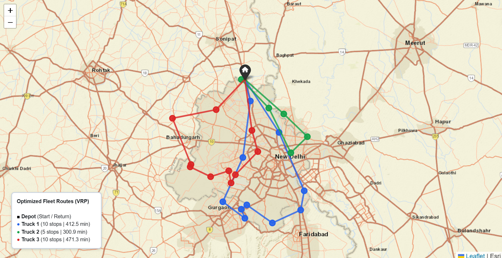

# Urban Delivery Route Optimization Model (SQL, Python, ML & OR-Tools)

An end-to-end logistics analytics and route optimization pipeline that cleans **2.04M+ raw shipment records** in SQL, diagnoses corridor-level congestion bottlenecks, predicts transit times using Gradient Boosting ($R^2 = 0.891$), and optimizes multi-vehicle delivery dispatches using **Google OR-Tools**.

---

## Business Problem & Key Results

Standard routing engines minimize raw physical distance, often sending delivery vehicles into peak-hour gridlock, high-signal urban corridors, and low-visibility weather zones. By combining **SQL bottleneck analysis**, **ML travel-time prediction**, and **multi-objective Vehicle Routing (VRP)**, this model balances fuel distance against driver transit time:

| Metric | Naive Baseline (Distance-Only) | Congestion-Aware Model (ML + OR-Tools) | Impact |
| :--- | :---: | :---: | :---: |
| **Total Fleet Travel Time** | 1,630.7 min | **1,184.7 min** | **-27.4% Time Saved** |
| **Total Operational Cost** | $736.39 | **$564.00** | **-23.4% Cost Saved** |
| **Total Fleet Distance** | 382.3 km | 409.7 km | +7.2% detour around gridlock |

> **Key Takeaway:** Taking slightly longer bypass routes (+27.4 km across 3 trucks) avoided severe congestion bottlenecks, saving **446 minutes** of driver transit time and **$172.39** per dispatch cycle.

---

## Visual Fleet Dispatch Map



**[Click Here to Explore the Live Interactive Route Map](https://sravankumar-data.github.io/route-optimization-model/assets/dispatch_routes_map.html)** *(Hosted via GitHub Pages — zoom in and click any stop to inspect road type, traffic, and weather details)*

*To view locally: open ssets/dispatch_routes_map.html in any web browser or run python src/06_visualize_routes.py.*

---

## Project Architecture & Workflow

```text
route-optimization-model/
├── sql/
│   ├── 01_clean_data.sql          # Deduplication, timestamp parsing, typo normalization & outlier filtering
│   └── 02_corridor_analysis.sql   # Master relational view & percentile congestion benchmarking
├── src/
│   ├── 01_inspect_data.py         # Schema & missing-value profiling across 4 raw tables
│   ├── 02_run_cleaning.py         # Executes DuckDB SQL pipeline to build data/logistics.duckdb
│   ├── 03_analyze_bottlenecks.py  # Exports corridor, rush-hour, and weather congestion reports
│   ├── 04_train_predictor.py      # Trains HistGradientBoostingRegressor (R2 = 0.891, MAE = 5.03 min)
│   └── 05_optimize_routes.py      # Multi-vehicle OR-Tools solver balancing speed & operational cost
├── data/
│   ├── report_inefficient_corridors.csv
│   ├── report_hourly_congestion.csv
│   ├── report_weather_traffic.csv
│   └── optimization_results.csv
├── requirements.txt
└── README.md


